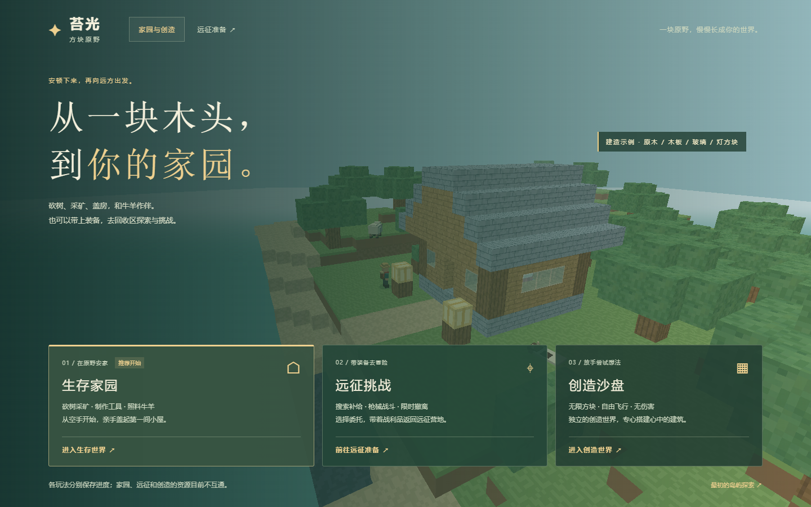
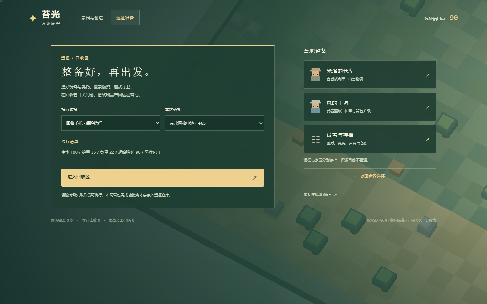

# 苔光 · 方块原野

一个本地运行的体素游戏原型：在家园砍树、采矿、建造和照顾牛羊，也可以前往回收区进行枪战与撤离。

目前家园、创造沙盘与远征使用独立存档。正在讨论以“修复世界”为主线串起玩法，具体方案见 [玩法融合提案](docs/玩法融合提案.md)。本仓库不会把尚未实现的共享经济描述成已有功能。

## 开始游戏

需要 Node.js 22 或更高版本。游戏运行本身不需要安装 npm 依赖。

```sh
git clone https://github.com/dfdf448/mosslight-blockland.git
cd mosslight-blockland
node serve.cjs
```

浏览器打开 <http://127.0.0.1:8790/>。游戏资源均在 `dist/` 内，无运行时外部 CDN、广告或联网账号依赖。也可以用任意静态服务器提供 `dist/`。

GitHub 源码不包含 Windows 便携运行时。Windows 源码用户可以直接运行上述命令；需要登录自动启动时，安装 Node.js 后运行“修复启动.cmd”；也可以使用带运行时的便携包。后台仅监听127.0.0.1，可用“关闭自启动.cmd”移除任务。

## 已有玩法

- **生存家园：** 砍树、采石、制作工具与工作台，逐层搭房和拆除，昼夜与温和重生。
- **创造沙盘：** 无限方块、飞行、自由建造，独立保存。
- **远征挑战：** 三种枪械、有限弹药、首领、负重背包、搜箱与限时撤离，成功带出物资后入远征仓库。
- **牛羊：** 3 头牛、4 只羊，会漫游、休息和跟随；走近并对准后按 E 喂浆果。
- **镜头：** 鼠标无需按住按键即可环视，V 切第一/第三人称，Esc 释放鼠标并暂停。

## 常用操作

| 家园 | 操作 |
| --- | --- |
| 移动、跳跃 | WASD、空格 |
| 环视、暂停 | 移动鼠标、Esc |
| 采集、放置 | 按住左键、右键 |
| 选择方块、打开制作 | 1—9 / 滚轮、B / Tab |
| 切换镜头、创造飞行 | V、F；飞行时空格升、Shift 降 |
| 使用设施、喂动物、吃浆果 | E、H |

远征内按 R 换弹、空格翻滚、E 搜索，完整操作见游戏设置。触屏使用双摇杆和屏幕按钮。

## 保存与备份

进度保存在当前浏览器、当前地址的本地存储。菜单可导出和导入 JSON 世界备份；导入前会要求确认。更换浏览器、电脑或站点地址前请先导出，文件不会自动上传 GitHub。

## 开发与验证

```sh
npm install
npm test
```

核心测试不需要浏览器。浏览器测试需要本机 Chrome / Edge，或 `npx playwright install chromium` 安装测试浏览器，然后执行 `npm run test:browser`。可通过 `CHROME_PATH` 指定浏览器。

代码注释、设计说明与交互文案优先使用简体中文。核心逻辑与 WebGL 画面分离，物资和存档迁移需要验证旧档、重复提交和异常恢复。

## 界面预览





## 当前范围

家园为 48×48、24 格高的单人世界。远征使用独立战斗地图；当前没有多人联机、无限地形、动物繁殖或完整的跨模式物品流通。下一步目标是先做完“点亮归航灯”的真实闭环，再扩展系统。

## 第三方组件

Three.js 的许可证随 `dist/vendor/THREE-LICENSE.txt` 保留。开发测试使用 Playwright。详见 [第三方许可说明](第三方许可说明.md)。仓库不包含玩家存档、个人配置、API 密钥、运行日志和历史便携包。

